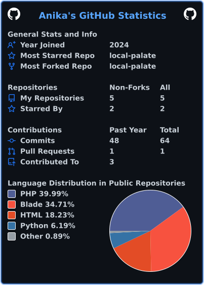

# Hi there! 👋 I'm Anika Rashid

🎓 Computer Science and Engineering student at BRAC University.

I'm passionate about software development, problem-solving, and exploring how technology can solve real-world problems.

### 🌱 About Me
- 💻 Interested in software engineering and machine learning.
- 🔍 Enjoy building practical projects and exploring new technologies.
- 📚 Exploring web development, computer graphics, and research.
- 🤝 Enjoy collaborating on academic and technical projects.

### 🛠️ Tech Stack

**Programming Languages**

**Web Development & Databases**

**Tools**

### 🚀 Projects

#### 💗 Personal Project

**Crafty Charms**

A project connected to my handmade resin art business, focused on bringing my small business online. Repository currently under development.

[View Repository](https://github.com/AnikaRashid12/craftycharms)

#### 💻 Individual Academic Project

**Local Palate**

A restaurant review platform where users can explore restaurants, submit ratings and reviews, manage wishlists, and discover trending places.

- Type: Individual University Course Project
- Technologies: Laravel, PHP, MySQL

[View Repository](https://github.com/AnikaRashid12/local-palate)

#### 🎓 Collaborative Academic Projects

**1. Zombie Survival**

A 3D zombie survival game featuring enemy waves, shooting mechanics, health management, and boss battles.

- Technologies: Python, OpenGL

[View Repository](https://github.com/AnikaRashid12/Zombie-Survival)

**2. Harry Potter Trivia Game**

An interactive trivia game featuring multiple difficulty levels, scoring, life tracking, and an admin management system.

[View Repository](https://github.com/AnikaRashid12/Harry-Potter-Trivia-Game)

**3. DHOR**

A collaborative web development project involving API development and database integration.

[View Repository](https://github.com/Imteaz-Sajid/Dhor)

**4. Customer Churn Prediction**

A machine learning project focused on analyzing customer data and predicting customer churn.

[View Repository](https://github.com/TanziaMehrin03/Customer-Churn-Prediction)

**5. Student Academic Performance Prediction**

A machine learning project focused on analyzing student data and predicting academic performance.

[View Repository](https://github.com/TanziaMehrin03/Student-Academic-Performance-Prediction)

### 📊 GitHub Statistics

  

### 📫 Connect With Me

- GitHub: [AnikaRashid12](https://github.com/AnikaRashid12)
- Email: Available through my GitHub profile
- Profile : https://anika-portfolio-theta.vercel.app/
---

⭐ Thanks for visiting my profile!
